<p align="center">
  
</p>

<p align="center">
  <a href="README.md">English</a> · <b>Italiano</b>
</p>

<p align="center">
  <a href="https://github.com/maxpy9/CasaOS-Windows/releases/latest"></a>
  
  
  <a href="LICENSE"></a>
</p>

> [!IMPORTANT]
> **Questo non è un progetto ufficiale.** È un porting indipendente, senza legami con IceWhale Technology, che non lo ha approvato e non lo supporta. Se qualcosa non funziona, [apri una segnalazione qui](https://github.com/maxpy9/CasaOS-Windows/issues), non nei repository ufficiali di CasaOS. Il nome e il logo di CasaOS appartengono ai rispettivi proprietari.

[CasaOS](https://github.com/IceWhaleTech/CasaOS) è una dashboard semplice per avere un cloud in casa: i tuoi file, le tue app, una sola pagina nel browser. Ufficialmente funziona solo su Linux, come un insieme di servizi sempre attivi.

Questo porting lo porta su Windows come un normale programma. Lo installi con una procedura guidata, premi **Avvia server** e ottieni il link alla dashboard completa. Premi **Ferma server** e non resta nulla in esecuzione.

<p align="center">
  <a href="https://github.com/maxpy9/CasaOS-Windows/releases/latest"></a>
</p>

<p align="center">
  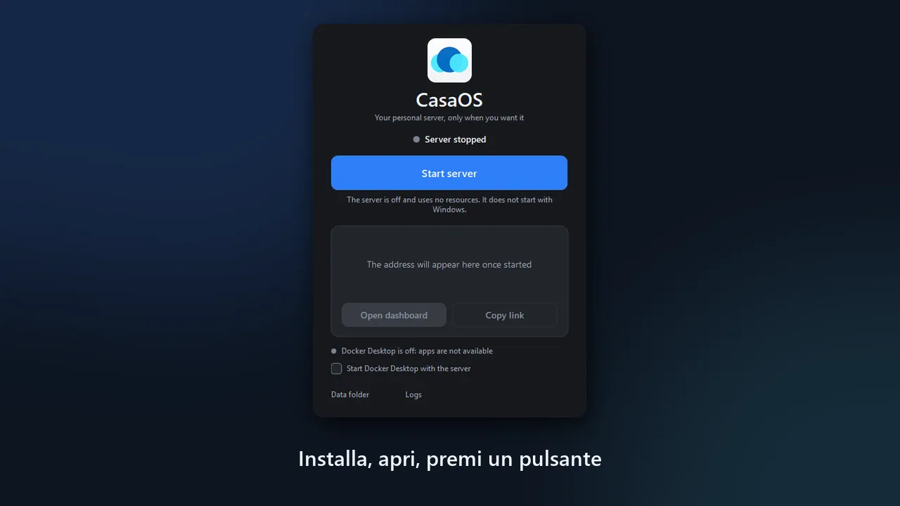
</p>

## Cosa lo rende diverso

| | |
|---|---|
| **Gira in modo nativo** | I sei servizi di CasaOS sono veri programmi Windows. Dashboard e file manager non richiedono né WSL né macchine virtuali. |
| **Acceso solo quando vuoi** | Nessun servizio di Windows, nessuna attività pianificata, nessun avvio con Windows. Da spento non consuma nulla. |
| **Si installa come tutti i programmi** | Una normale procedura guidata, senza terminale e senza permessi di amministratore. Si disinstalla con la stessa facilità. |
| **La dashboard vera** | La dashboard ufficiale di CasaOS, non modificata. Il porting lavora sotto di lei. |
| **Tutto il tuo PC** | `C:`, `D:` e gli altri dischi compaiono nel file manager, accanto alla cartella dati di CasaOS. |
| **App tramite Docker Desktop** | Il catalogo dell'App Store (667 app all'ultimo controllo) installa le app come container. Questa parte richiede Docker Desktop e [non è ancora stata provata fino in fondo](#stato). |

## Come iniziare

1. Scarica `CasaOS-Setup-0.4.15.exe` dall'[ultima versione](https://github.com/maxpy9/CasaOS-Windows/releases/latest).
2. Avvialo e scegli dove tenere i tuoi file.
3. Apri **CasaOS**, premi **Avvia server** e poi **Apri dashboard**.
4. **Crea subito il tuo account.** Finché il primo account non esiste, chiunque raggiunga l'indirizzo potrebbe crearlo.

Serve Windows 10 versione 1809 o successiva, oppure Windows 11, a 64 bit. Finora è stato provato solo Windows 11. Per installare le app serve anche [Docker Desktop](https://www.docker.com/products/docker-desktop/).

> [!NOTE]
> I programmi non sono firmati con un certificato a pagamento, quindi la prima volta può succedere che:
> - **SmartScreen** dica "Windows ha protetto il PC". Scegli *Ulteriori informazioni* e poi *Esegui comunque*.
> - **L'antivirus** trattenga i servizi per un po' per analizzarli. La finestra se ne accorge e te lo dice, invece di dare errore.
> - **Il Firewall di Windows** chieda il permesso di rete. Consenti le reti private solo se vuoi aprire la dashboard dal telefono o da un altro PC.
>
> Ogni versione riporta lo SHA256 dell'installer, e puoi anche [compilarlo da solo](#compilarlo-da-solo) da questo codice.

## Uno sguardo

Schermate reali, prese da una copia di prova con un account vuoto. Sono in inglese: su un Windows in italiano la finestra è in italiano.

<table>
  <tr>
    <td width="32%" align="center">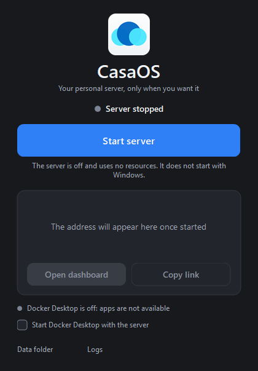<br><sub>Spento, e non consuma nulla</sub></td>
    <td width="68%" align="center">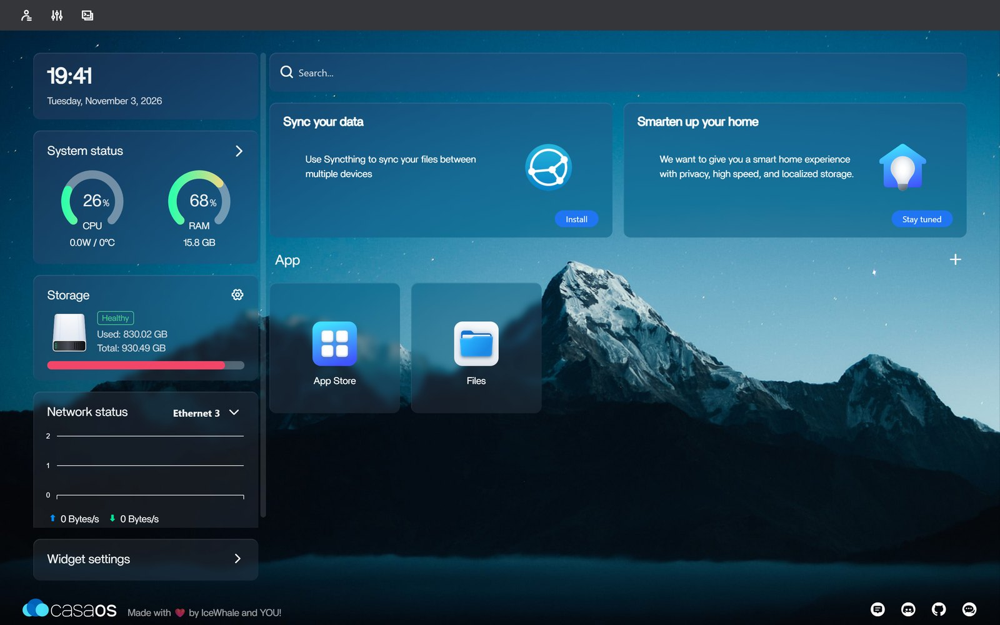<br><sub>La dashboard, con CPU, memoria, dischi e rete in tempo reale</sub></td>
  </tr>
  <tr>
    <td width="32%" align="center">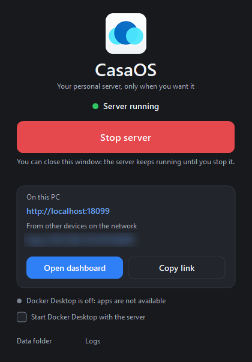<br><sub>Acceso, con i link (indirizzo di rete sfocato)</sub></td>
    <td width="68%" align="center">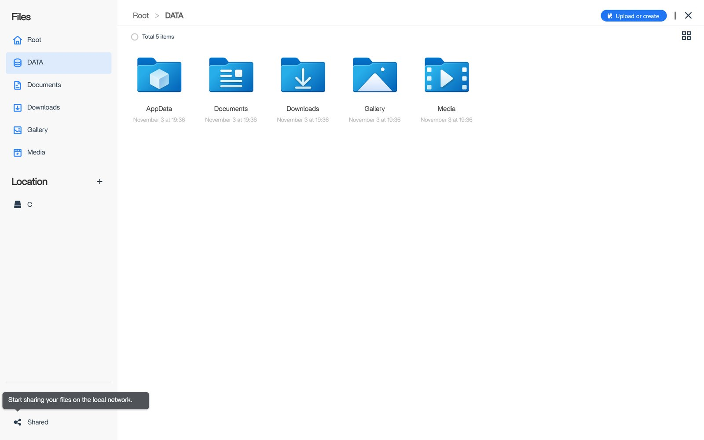<br><sub>File: la cartella dati e i dischi del PC</sub></td>
  </tr>
  <tr>
    <td colspan="2" align="center">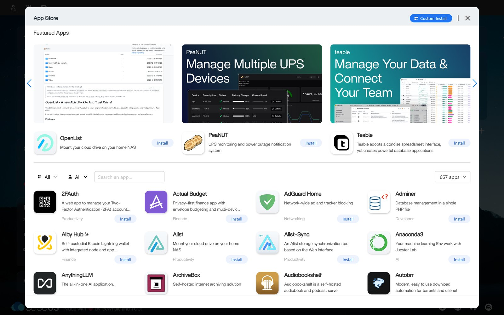<br><sub>Il catalogo dell'App Store</sub></td>
  </tr>
</table>

## Come funziona

### Acceso e spento, davvero

Su Linux, CasaOS dà per scontato di avere la macchina tutta per sé e resta sempre attivo. Ha senso per un server, non per il portatile che usi anche per tutto il resto.

<p align="center"></p>

### Una finestra che comanda

CasaOS non è un programma solo, ma sei, e su Linux a tenerli in piedi è `systemd`. Qui quel compito spetta a `CasaOS.exe`.

<p align="center">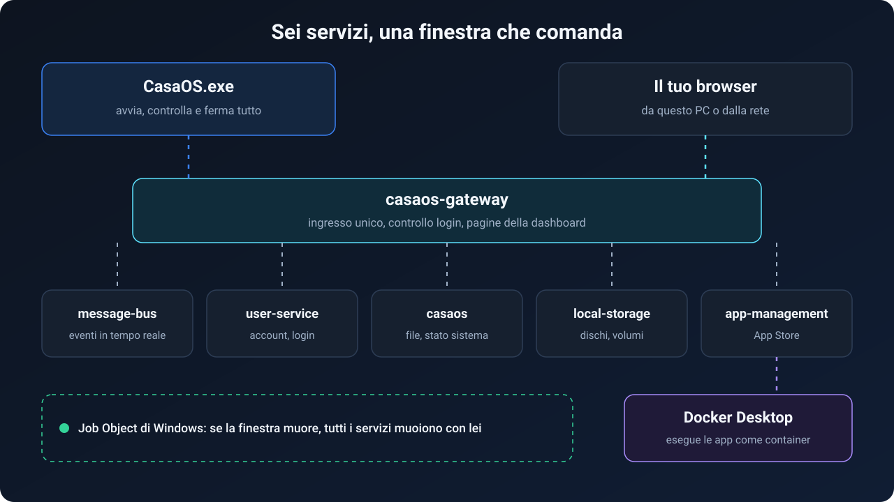</p>

Il launcher avvia ogni servizio in ordine e aspetta che sia pronto. Se uno si ferma lo riavvia, fino a cinque volte in due minuti, poi spegne il server e te lo segnala. Tutti i servizi stanno dentro un Job Object di Windows: anche se il launcher viene terminato a forza, Windows chiude anche loro e non resta nulla.

Sul PC di prova il server parte in circa 4 secondi e si ferma in meno di uno, una volta che l'antivirus ha finito con i programmi nuovi.

### Percorsi Linux su un disco Windows

Dashboard e API sono piene di percorsi come `/DATA` e `/var/lib/casaos`. Riscriverli tutti avrebbe voluto dire modificare la dashboard, quindi restano. Un piccolo pacchetto, [`vfs`](CasaOS-Common/utils/vfs), li traduce all'ultimo momento.

<p align="center">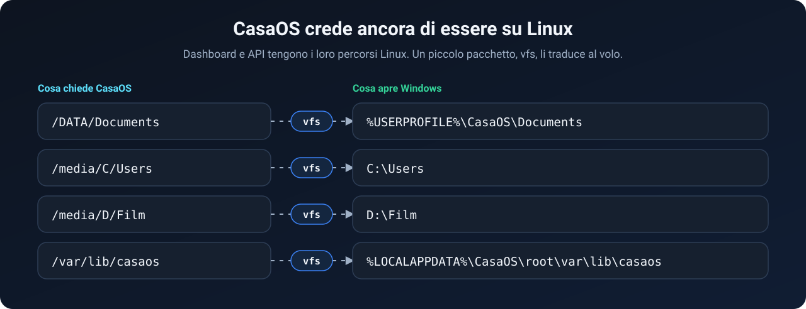</p>

### Cosa è stato sostituito

<p align="center">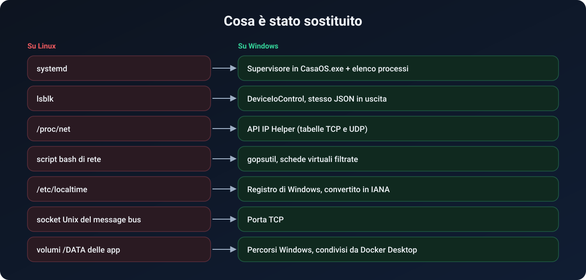</p>

<details>
<summary><b>I dettagli tecnici, file per file</b></summary>

**Launcher** ([`CasaOS-Windows/launcher`](CasaOS-Windows/launcher))
- `ui.go`, `win32.go`, `i18n.go`: una finestra nativa scritta in Go che chiama direttamente `user32`, `gdi32`, `gdiplus`, `dwmapi` e `shell32`, senza WebView né Electron. Tema chiaro e scuro, HiDPI, icona nell'area di notifica, italiano e inglese.
- `server.go`: avvia `casaos-gateway`, `casaos-message-bus`, `casaos-user-service`, `casaos`, `casaos-local-storage` e `casaos-app-management` in quest'ordine. Se la porta 80 è occupata, il gateway ne sceglie una libera.
- `suspended.go`: legge lo stato dei thread con `NtQuerySystemInformation`. Se tutti i thread di un servizio sono sospesi, probabilmente un antivirus lo sta analizzando: la finestra aspetta e lo dice, invece di segnalare un guasto.
- `docker.go`: controlla Docker attraverso la named pipe `\\.\pipe\docker_engine`. Quando fermi il server, ferma solo i container creati da CasaOS, li ricorda in `apps-stopped-with-server.json` e li riavvia la volta dopo. Gli altri container non vengono toccati, e Docker Desktop viene chiuso solo se l'ha aperto il launcher.

**Percorsi** ([`CasaOS-Common/utils/vfs`](CasaOS-Common/utils/vfs))
- `vfs.Real` trasforma un percorso di CasaOS in un percorso Windows, e `vfs.Virtual` fa il contrario prima di rispondere alla dashboard. Su Linux entrambe restituiscono il percorso così com'è.

**Le versioni Windows delle parti Linux**

| Linux | Windows | File |
|---|---|---|
| `lsblk -O -J -b` | `DeviceIoControl`, `GetVolumeInformation`, `GetDiskFreeSpaceEx`, senza permessi di amministratore | [`lsblk_windows.go`](CasaOS-LocalStorage/pkg/utils/command/lsblk_windows.go) |
| `systemctl` | `CreateToolhelp32Snapshot` | [`systemctl_windows.go`](CasaOS-Common/utils/systemctl/systemctl_windows.go) |
| `/proc/net/{tcp,udp}` | `GetExtendedTcpTable`, `GetExtendedUdpTable` | [`ports_in_use_windows.go`](CasaOS-Common/utils/port/ports_in_use_windows.go) |
| script bash di rete | `gopsutil`, nascondendo le schede WSL, Hyper-V, Docker e VPN | [`system_windows.go`](CasaOS/service/system_windows.go) |
| `/etc/localtime` | `TimeZoneKeyName` dal Registro, convertito in IANA | [`utils_windows.go`](CasaOS-Common/utils/time/utils_windows.go) |
| volumi delle app su `/DATA` | `useHostVolumePaths()` mette il percorso Windows | [`volume_path.go`](CasaOS-AppManagement/service/volume_path.go) |

</details>

## Come è stato creato

<p align="center"></p>

L'idea è di [maxpy9](https://github.com/maxpy9): CasaOS su Windows senza terminale, comandato da un solo pulsante. Il codice è stato scritto con [Claude Code](https://claude.com/claude-code), lo strumento di programmazione con IA di Anthropic, e provato facendolo girare su un PC vero. Lo dicono anche i commit. È un software giovane, quindi giudicalo dalla [tabella dello stato](#stato) più che da quanto è curata questa pagina.

Girare su Windows ha fatto emergere problemi che su Linux restavano nascosti:

- Un cast `unsafe` tra due strutture di dimensioni diverse nei contatori di rete leggeva oltre la fine della variabile e faceva cadere il servizio.
- File lasciati aperti, che Linux tollera ma che su Windows impediscono di rinominarli e cancellarli.
- Errori fatali quando il message bus non era ancora pronto, e crash su una richiesta GET senza `Content-Type`.
- Il file del socket del message bus non si poteva cancellare dopo l'uso, e questo rompeva il secondo avvio. Su Windows ora usa una porta TCP.

## Stato

| | Funzione | |
|---|---|---|
| ✅ | Installazione dalla procedura guidata, apertura della dashboard | Provato |
| ✅ | Avvii e arresti ripetuti del server | Provato |
| ✅ | Account, login, file manager, catalogo dell'App Store | Provato |
| ✅ | Docker Desktop che si avvia e si ferma con il server | Provato |
| ✅ | Disinstallazione | Provata in ambiente di test |
| 🟡 | **Installazione di un'app reale dall'App Store** | **Non ancora provata** |
| 🟡 | App che si fermano e tornano con il server | Non provato con un'app reale |
| 🟡 | Apertura della dashboard da un altro dispositivo | Non ancora provata |
| 🟡 | Windows 10, altre build di Windows 11, altri antivirus | Non ancora provati |
| ❌ | Condivisioni Samba e cartelle di rete | Non disponibili |
| ❌ | Google Drive, Dropbox, OneDrive | Non disponibili |
| ❌ | Formattazione e partizionamento, mergerfs, espulsione USB | Non disponibili |
| ❌ | Dati S.M.A.R.T., temperatura e consumo della CPU (mostrano 0) | Non disponibili |
| ❌ | Aggiornamento dalla dashboard (quelli ufficiali sono programmi Linux) | Non disponibile |

Finora tutte le prove sono state fatte su un solo PC con Windows 11 e Norton 360. Il terminale della dashboard si collega via SSH, quindi serve OpenSSH Server di Windows. Dentro Docker Desktop, le app che usano `network_mode: host` o dispositivi hardware possono comportarsi diversamente che su Linux.

## Sicurezza

- **I browser devono sempre fare il login.** CasaOS si fida delle richieste da `127.0.0.1`. Su un PC desktop, questo permetterebbe a qualunque sito aperto nel browser di raggiungere `http://localhost` e leggere i tuoi file. Quindi qui il gateway tratta come remota ogni richiesta il cui `User-Agent` inizia con `Mozilla/`, e deve portare un token di login. Gli altri programmi sul PC restano considerati locali, come nell'originale.
- **I tuoi dischi si raggiungono dalla dashboard.** Chi ha il tuo account può sfogliare tutti i dischi del PC dalla rete. Usa una password robusta e non esporre la porta su Internet.
- **Radici protette.** Il file manager non cancella, sposta o rinomina `/`, `/DATA`, `/media` e la radice di un disco.
- **Nessuna chiave integrata.** I sorgenti originali contenevano credenziali OAuth per Google Drive, Dropbox e GitHub. Sono state rimosse, dato che quelle funzioni su Windows non sono attive.

Hai trovato un problema? Apri una segnalazione, e per le cose delicate evita di pubblicare i dettagli.

## Dove stanno i tuoi dati

| Cosa | Dove | Quando disinstalli |
|---|---|---|
| Programmi e dashboard | `%LOCALAPPDATA%\Programs\CasaOS` | Rimossi |
| I tuoi file e i dati delle app (`/DATA`) | Scelta nell'installer, di default `%USERPROFILE%\CasaOS` | **Mai toccati** |
| Account, impostazioni, log | `%LOCALAPPDATA%\CasaOS\root` | Te lo chiede il programma |

## Compilarlo da solo

Lo script di preparazione non installa nulla nel sistema: scarica copie portatili di Go, Inno Setup e della dashboard dentro `_tools`.

```powershell
.\CasaOS-Windows\setup-tools.ps1
.\CasaOS-Windows\build.ps1
```

L'installer finisce in `CasaOS-Windows\dist`. Se PowerShell blocca gli script locali, avviali con `powershell -ExecutionPolicy Bypass -File <script>`. Altre opzioni sono nel [README del launcher](CasaOS-Windows/README.md).

## Domande frequenti

<details>
<summary><b>È una macchina virtuale o WSL?</b></summary>

No. I sei servizi di CasaOS sono programmi Windows nativi. Solo le app dell'App Store girano in un ambiente Linux, quello fornito da Docker Desktop.
</details>

<details>
<summary><b>Rallenta il PC quando non lo uso?</b></summary>

Da spento non gira nessun processo di CasaOS. E non parte con Windows.
</details>

<details>
<summary><b>Perché l'antivirus o SmartScreen si lamentano?</b></summary>

I programmi sono nuovi e non firmati con un certificato a pagamento, e tanto basta a far scattare questi avvisi. Il codice è tutto qui. Se preferisci non fidarti di un installer già pronto, puoi compilarti il tuo.
</details>

<details>
<summary><b>Posso chiudere la finestra?</b></summary>

Sì. A server acceso passa nell'area di notifica e resta attivo finché non lo fermi. A server spento, chiuderla chiude il programma.
</details>

<details>
<summary><b>Il pulsante "Spegni" della dashboard spegne il PC?</b></summary>

Sì. Spegni e Riavvia nella dashboard agiscono sul PC Windows vero.
</details>

## Serve una mano

La cosa più utile adesso è provarlo e raccontare cosa succede:

- **Installa un'app dall'App Store** con Docker Desktop, e facci sapere se funziona.
- **Provalo su Windows 10** o con un altro antivirus.
- **Apri la dashboard dal telefono** o da un altro PC.

[Apri una segnalazione](https://github.com/maxpy9/CasaOS-Windows/issues/new) con cosa hai provato e cosa hai visto. Anche le pull request sono benvenute. Se l'idea ti piace, una stella aiuta altre persone a trovarlo.

## Riconoscimenti e licenza

Tutto il lavoro che sta dietro a CasaOS è di [IceWhale Technology](https://github.com/IceWhaleTech) e di chi vi contribuisce. Questo progetto è distribuito con [licenza Apache 2.0](LICENSE), come gli originali, e le modifiche sono elencate in [NOTICE](NOTICE). Il software è fornito *così com'è*, senza garanzie.

| Cartella | Repository originale | Commit di partenza |
|---|---|---|
| `CasaOS` | [IceWhaleTech/CasaOS](https://github.com/IceWhaleTech/CasaOS) | `0d3b2f4` |
| `CasaOS-Common` | [IceWhaleTech/CasaOS-Common](https://github.com/IceWhaleTech/CasaOS-Common) | `909dcbd` (`v0.4.11-alpha4`) |
| `CasaOS-Gateway` | [IceWhaleTech/CasaOS-Gateway](https://github.com/IceWhaleTech/CasaOS-Gateway) | `606a845` |
| `CasaOS-MessageBus` | [IceWhaleTech/CasaOS-MessageBus](https://github.com/IceWhaleTech/CasaOS-MessageBus) | `ba87168` |
| `CasaOS-UserService` | [IceWhaleTech/CasaOS-UserService](https://github.com/IceWhaleTech/CasaOS-UserService) | `800c630` |
| `CasaOS-LocalStorage` | [IceWhaleTech/CasaOS-LocalStorage](https://github.com/IceWhaleTech/CasaOS-LocalStorage) | `a9b1280` |
| `CasaOS-AppManagement` | [IceWhaleTech/CasaOS-AppManagement](https://github.com/IceWhaleTech/CasaOS-AppManagement) | `debfa31` |

La dashboard nell'installer è la versione v0.4.25 di [CasaOS-UI](https://github.com/IceWhaleTech/CasaOS-UI), non modificata. `CasaOS-Windows` e `CasaOS-Common/utils/vfs` sono stati scritti per questo porting.
