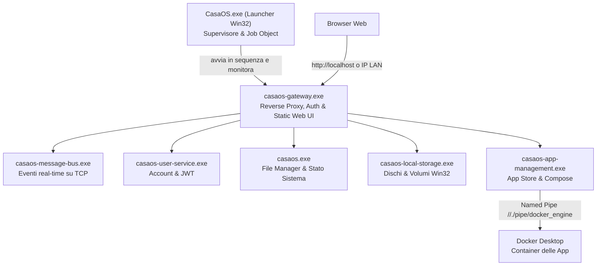

# CasaOS per Windows (Porting Non Ufficiale)

> [!IMPORTANT]
> **Questo NON è un progetto ufficiale.** È un porting indipendente pensato per rendere accessibile [CasaOS](https://github.com/IceWhaleTech/CasaOS) anche su Windows, senza alcun legame con IceWhale Technology, che non lo ha approvato e non lo supporta. Per problemi di questa versione apri una segnalazione in questo repository, non nei repository ufficiali di CasaOS. Il nome e il logo di CasaOS appartengono ai rispettivi proprietari.

*English: unofficial Windows port of CasaOS, not affiliated with or endorsed by IceWhale Technology. It brings the CasaOS dashboard and microservices to Windows with an on-demand launcher (turn it on and off whenever you want, with zero background services when stopped). Running containerized apps requires Docker Desktop.*

---

## Perché questo progetto

**CasaOS** nasce ufficialmente solo per Linux, dove viene installato tramite script di sistema, registra demoni `systemd` sempre attivi in background e assume di avere il controllo continuo della macchina.

Questo progetto nasce per **portare CasaOS su Windows** con una filosofia adatta a un PC desktop o portatile:
- **Attivabile quando vuoi (On-Demand):** a differenza della versione originale per Linux (sempre attiva), su Windows non viene installato **nessun servizio di sistema**, **nessuna attività pianificata** e **nessun avvio automatico**. Quando il server è spento non gira assolutamente nulla in background.
- **Gestione con un clic:** un launcher nativo (`CasaOS.exe`) permette di avviare il server (**Avvia server**) quando ti serve e fermarlo completamente (**Ferma server**) quando hai finito.
- **Integrazione con Docker Desktop:** per installare e usare le applicazioni dell'App Store di CasaOS è necessario scaricare **[Docker Desktop per Windows](https://www.docker.com/products/docker-desktop/)**. Il launcher rileva automaticamente Docker Desktop, può avviarlo insieme al server e ferma in automatico i container delle app di CasaOS quando spegni il server.
- **Installazione standard senza permessi di amministratore:** si installa con una classica procedura guidata (`CasaOS-Setup-*.exe`) nel profilo utente (`%LOCALAPPDATA%\Programs\CasaOS`), senza bisogno del terminale o di privilegi amministrativi.

---

## Struttura del progetto

CasaOS non è un singolo eseguibile monolitico, ma un'architettura a **6 microservizi in Go** più una **dashboard web (`CasaOS-UI`)**. Questo repository raccoglie l'intero codice sorgente in un unico monorepo strutturato così:

```text
├── CasaOS-Windows/          # Scritto da zero per Windows: launcher GUI Win32, script di build e installer Inno Setup
│   ├── launcher/            # Codice sorgente di CasaOS.exe (GUI nativa, supervisore servizi, integrazione Docker)
│   ├── installer/           # Script Inno Setup (casaos.iss) per generare CasaOS-Setup-<versione>.exe
│   ├── setup-tools.ps1      # Scarica in modo portatile Go, Inno Setup e la release di CasaOS-UI
│   ├── generate.ps1         # Rigenera il codice API Go a partire dalle specifiche OpenAPI (oapi-codegen)
│   └── build.ps1            # Compila i 6 microservizi, il launcher e impacchetta l'installer finale
├── CasaOS-Common/           # Libreria condivisa + nuovo pacchetto utils/vfs e astrazioni Windows (porte, systemctl, fuso orario)
├── CasaOS-Gateway/          # API Gateway HTTP (punto d'ingresso unico, reverse proxy e filtro di autenticazione)
├── CasaOS-MessageBus/       # Bus degli eventi in tempo reale (WebSocket / HTTP per aggiornare la UI)
├── CasaOS-UserService/      # Gestione account utente, registrazione, login e token JWT
├── CasaOS/                  # Servizio principale: file manager, stato hardware/sistema, rete e condivisioni
├── CasaOS-LocalStorage/     # Gestione dischi fisici, partizioni e volumi (riscritto con API Win32 DeviceIoControl)
└── CasaOS-AppManagement/    # App Store, gestione cataloghi Docker Compose e traduzione volumi per Docker Desktop
```

---

## Come è stato creato e come funziona il codice

Per far girare nativamente su Windows un sistema progettato per il kernel e l'ecosistema Linux (`systemd`, `/proc`, `lsblk`, `smartctl`, `mergerfs`, socket Unix, percorsi POSIX), il porting interviene su più livelli senza alterare la dashboard originale (`CasaOS-UI` v0.4.25).



### 1. Il Launcher e Supervisore Nativo (`CasaOS-Windows/launcher`)
Su Linux l'avvio ordinato dei servizi e il loro riavvio in caso di crash sono affidati a `systemd`. Su Windows questo ruolo è svolto da `CasaOS.exe`:
- **Interfaccia grafica nativa Win32 (`ui.go`, `win32.go`, `i18n.go`):** scritta interamente in Go chiamando direttamente le DLL di sistema (`user32.dll`, `gdi32.dll`, `gdiplus.dll`, `dwmapi.dll`, `shell32.dll`). Non richiede WebView, Electron o runtime esterni. Supporta tema chiaro/scuro automatico da registro di Windows, scaling HiDPI (`PerMonitorV2`), icona nella System Tray e localizzazione Italiano/Inglese.
- **Orchestrazione sequenziale (`server.go`):** avvia i 6 servizi nell'ordine esatto delle dipendenze (`casaos-gateway` → `casaos-message-bus` → `casaos-user-service` → `casaos` → `casaos-local-storage` → `casaos-app-management`). Per ciascun servizio attende che venga scritto il relativo file `.url` nella cartella runtime (`/var/run/casaos`), verifica la risposta HTTP del gateway e registra gli eventi della UI (`ui-message-bus.json`).
- **Isolamento con Windows Job Object (`newKillOnCloseJob`):** tutti i processi figli vengono assegnati a un *Job Object* di Windows configurato con `JOB_OBJECT_LIMIT_KILL_ON_JOB_CLOSE`. Se il launcher viene chiuso o termina in modo anomalo, il kernel di Windows termina istantaneamente tutti i microservizi, garantendo che non restino mai processi orfani in background.
- **Auto-healing e gestione porta occupata:** se un microservizio termina inaspettatamente mentre il server è attivo, il launcher lo riavvia automaticamente (fino a 5 volte in 2 minuti, dopodiché segnala l'errore e ferma il server). Prima dell'avvio controlla anche se la porta salvata in `gateway.ini` (es. la porta 80) è stata occupata da un altro programma Windows: in tal caso la libera nella configurazione così il gateway ne sceglie automaticamente una libera.
- **Rilevamento blocco Antivirus (`suspended.go`):** al primo avvio di eseguibili non firmati, gli antivirus (es. Norton 360, Windows Defender) possono congelare temporaneamente il processo per analizzarlo. Tramite la syscall nativa `NtQuerySystemInformation(SystemProcessInformation)`, il launcher ispeziona lo stato dei thread di ogni servizio: se rileva che tutti i thread di un servizio sono sospesi (`waitReasonSuspended`), non dichiara timeout ma mostra un avviso all'utente e attende che l'antivirus completi la scansione.

### 2. Integrazione con Docker Desktop (`CasaOS-Windows/launcher/docker.go` e `CasaOS-AppManagement`)
Le app di CasaOS sono container Linux gestiti tramite Docker Compose:
- **Controllo del motore Docker:** il launcher verifica la disponibilità del demone Docker interrogando direttamente la named pipe di Windows `\\.\pipe\docker_engine` (`GET http://docker/_ping`).
- **Avvio e arresto sincronizzati:** se l'opzione *"Avvia Docker Desktop insieme al server"* è attiva, `CasaOS.exe` avvia `Docker Desktop.exe` all'accensione del server. Quando premi **Ferma server**, il launcher individua solo i container creati da CasaOS (controllando la label `com.docker.compose.project.working_dir` sotto la cartella `apps` di CasaOS), salva i loro ID in `apps-stopped-with-server.json`, li ferma con `docker stop` e, al successivo avvio del server, li riavvia automaticamente. I container personali non creati da CasaOS non vengono mai toccati, e Docker Desktop viene chiuso solo se era stato avviato dal launcher stesso.
- **Traduzione dei volumi per la VM di Docker Desktop (`CasaOS-AppManagement/service/volume_path.go`):** le app nello store di CasaOS montano percorsi Linux come `/DATA/AppData/...` o `/media/...`. Prima di creare i container, `useHostVolumePaths()` traduce i percorsi appartenenti all'host nei corrispondenti percorsi Windows reali (che Docker Desktop condivide con la propria macchina virtuale Linux), lasciando invece invariati i percorsi interni alla VM come `/var/run/docker.sock`.

### 3. Il Virtual File System (`CasaOS-Common/utils/vfs`)
Il codice originale di CasaOS e la dashboard web usano ovunque percorsi POSIX cablati (`/DATA`, `/var/lib/casaos`, `/etc/casaos`, `/media/...`). Per non dover riscrivere la dashboard web né rompere le API REST, è stato creato il pacchetto [`CasaOS-Common/utils/vfs`](CasaOS-Common/utils/vfs):
- `vfs.Real(path)` converte al volo i percorsi virtuali di CasaOS nei percorsi reali di Windows:
  - `/DATA/...` → `%CASAOS_DATA%` (scelta nell'installer, di default `%USERPROFILE%\CasaOS`)
  - `/media/C/...`, `/media/D/...` → `C:\...`, `D:\...` (tutte le unità disco rilevate da `GetLogicalDrives()`)
  - `/etc/casaos`, `/var/lib/casaos`, `/var/log/casaos`, `/var/run/casaos` → `%CASAOS_ROOT%\...` (di default `%LOCALAPPDATA%\CasaOS\root\...`)
- `vfs.Virtual(path)` esegue la conversione inversa prima di restituire i percorsi nelle risposte JSON alla dashboard.
- `vfs.SocketPath(path)` gestisce il limite di 108 byte dei socket Unix su Windows, generando un percorso breve in `%TEMP%` se il nome utente di Windows rende il percorso troppo lungo.

### 4. Sostituzione dei componenti specifici di Linux nei 6 microservizi
| Componente Linux originale | Implementazione per Windows in questo porting |
|---|---|
| `lsblk -O -J -b` (`CasaOS-LocalStorage`) | Riscritto in [`lsblk_windows.go`](CasaOS-LocalStorage/pkg/utils/command/lsblk_windows.go) usando chiamate Win32 `DeviceIoControl` (`IOCTL_STORAGE_QUERY_PROPERTY`, `IOCTL_DISK_GET_DRIVE_GEOMETRY_EX`, `IOCTL_VOLUME_GET_VOLUME_DISK_EXTENTS`, `GetVolumeInformation`, `GetDiskFreeSpaceEx`) senza richiedere permessi di amministratore, producendo lo stesso identico JSON di `lsblk`. |
| `systemd` / `systemctl` (`CasaOS-Common`) | Riscritto in [`systemctl_windows.go`](CasaOS-Common/utils/systemctl/systemctl_windows.go) ispezionando i processi attivi tramite `CreateToolhelp32Snapshot`. |
| `/proc/net/{tcp,udp}` (`CasaOS-Common`) | Riscritto in [`ports_in_use_windows.go`](CasaOS-Common/utils/port/ports_in_use_windows.go) interrogando le tabelle TCP/UDP IPv4 e IPv6 tramite `iphlpapi.dll` (`GetExtendedTcpTable` e `GetExtendedUdpTable`). |
| Script bash di rete (`CasaOS`) | Sostituiti in [`system_windows.go`](CasaOS/service/system_windows.go) con `gopsutil` e filtro automatico delle schede virtuali (WSL, Hyper-V, Docker, VPN, loopback). |
| `/etc/localtime` (`CasaOS-Common`) | Sostituito in [`utils_windows.go`](CasaOS-Common/utils/time/utils_windows.go) leggendo `TimeZoneKeyName` dal Registro di Windows e convertendolo nel formato IANA (es. `W. Europe Standard Time` → `Europe/Berlin`) richiesto dai container Docker. |
| Socket e uevent kernel (`CasaOS-LocalStorage`) | Disaccoppiato il listener Netlink KObject uevent del kernel Linux tramite build tag (`misc_windows.go`, `message_uevent.go`). |

### 5. Sicurezza e bug corretti rispetto al codice originale
- **Autenticazione obbligatoria per i browser in locale (`CasaOS-Gateway/route/gateway_route.go`):** i microservizi di CasaOS comunicano tra loro su `127.0.0.1` senza token, perciò il gateway originale lascia passare senza login qualsiasi richiesta proveniente da localhost. Su un PC desktop questo permetterebbe a qualsiasi pagina web aperta nel browser di invocare `http://localhost` (CSRF/DNS rebinding) e leggere i file del PC. In questo porting il gateway tratta come remota ogni richiesta il cui `User-Agent` inizia con `Mozilla/`, cioè quelle dei browser: devono sempre portare il token JWT di login, anche da `127.0.0.1`. Il controllo vale per i browser, non per gli altri programmi in esecuzione sul PC, che restano considerati locali come nell'originale.
- **Protezione delle radici nel File Manager (`CasaOS/service/system_windows.go`):** impedita l'eliminazione, la rinomina o lo spostamento accidentale di `/`, `/DATA`, `/media` e delle radici dei dischi (`/media/C`, `/media/D`, ecc.).
- **Accesso ai dischi dalla rete:** chi ha il tuo account può sfogliare tutti i dischi del PC dalla dashboard. Usa una password robusta e non esporre la porta su Internet.
- **Rimozione credenziali OAuth integrate (`NOTICE`):** i sorgenti upstream contenevano credenziali OAuth cablate per Google Drive, Dropbox e GitHub, usate da funzioni che su Windows non sono attive. Sono state rimosse dal codice. Per usare quelle funzioni in una build derivata servono credenziali proprie.
- **Correzioni di bug upstream:**
  - Corretto in `CasaOS/model/net.go` un cast `unsafe` tra `net.IOCountersStat` di `gopsutil` e una struct locale più lunga, che causava letture di memoria fuori limite e crash su Windows.
  - Aggiunta la chiusura esplicita dei file (`defer f.Close()`) nel file manager e nelle immagini profilo: a differenza di Linux, Windows blocca la rinomina e la cancellazione dei file lasciati aperti.
  - Resi non fatali gli errori di connessione iniziale al message bus durante l'avvio concorrente dei servizi.

---

## Installazione e Uso Quotidiano

### Requisiti
- **Windows 10** (versione 1809 o successiva) o **Windows 11** a 64 bit.
- **[Docker Desktop](https://www.docker.com/products/docker-desktop/)** (necessario per installare e avviare le app dell'App Store; dashboard e file manager funzionano anche senza Docker).

### Passaggi di installazione
1. Scarica `CasaOS-Setup-*.exe` dalla sezione [Releases](../../releases/latest) (oppure compilalo dai sorgenti con le istruzioni più sotto).
2. Avvia l'installer e scegli dove salvare i tuoi file (la cartella `DATA` di CasaOS, di default `%USERPROFILE%\CasaOS`).
3. Apri **CasaOS**, clicca su **Avvia server** e poi su **Apri dashboard**.
4. Al primo accesso crea subito il tuo account utente: finché non viene creato il primo account, la dashboard è accessibile in rete locale per la configurazione iniziale.

> [!NOTE]
> Gli eseguibili **non sono firmati con un certificato Authenticode a pagamento**:
> - **Windows SmartScreen** può mostrare l'avviso *"Windows ha protetto il PC"*: clicca su *Ulteriori informazioni* → *Esegui comunque*.
> - L'**Antivirus** può sospendere i 6 servizi per alcuni secondi al primo avvio per analizzarli: il launcher lo rileva automaticamente e attende il completamento.
> - Il **Firewall di Windows** può chiedere il permesso di rete: consenti l'accesso sulle reti private se vuoi aprire la dashboard anche da smartphone o altri PC di casa.

### Comportamento del Launcher

| Azione | Cosa succede |
|---|---|
| **Avvia server** | Avvia in sequenza i 6 servizi (e Docker Desktop se spuntato) e mostra i link locale (`http://localhost:...`) e di rete locale (`http://192.168...`). |
| **Ferma server** | Ferma le app di CasaOS in esecuzione su Docker e chiude tutti i 6 servizi. Non resta alcun processo attivo in background. |
| **Chiudi finestra (`X`) a server acceso** | Il server resta attivo e la finestra si nasconde nell'area di notifica (System Tray) vicino all'orologio. |
| **Chiudi finestra (`X`) a server spento** | Chiude completamente il programma. |
| **Esci** (dal menu dell'icona nella Tray) | Ferma il server, ferma le app e chiude il programma. |
| **Spegni / Riavvia** (dalla dashboard web) | Esegue `shutdown.exe` spegnendo o riavviando **il PC Windows reale**. |

### Dove vengono salvati i dati

| Elemento | Percorso su Windows | Alla disinstallazione |
|---|---|---|
| Eseguibili e interfaccia web | `%LOCALAPPDATA%\Programs\CasaOS` | Eliminati |
| Cartella `/DATA` (file personali e dati delle app) | Scelta durante l'installazione (default `%USERPROFILE%\CasaOS`) | **Mai toccata in nessun caso** |
| Database SQLite, account, configurazioni e log | `%LOCALAPPDATA%\CasaOS\root` | L'installer chiede se conservarli o eliminarli |
| Unità disco del PC | Esplorate come `/media/C`, `/media/D`, ecc. | Non applicabile |

---

## Cosa funziona e limitazioni note

- **Funzionano:** Dashboard e widget di sistema (CPU, RAM, dischi, rete), creazione account e login, File Manager (esplorazione di `/DATA` e di tutti i dischi `C:`, `D:`, upload, download, anteprime, compressione zip, copia e spostamento) e catalogo dell'App Store.
- **Installazione delle app:** il codice per installarle e gestirle tramite Docker Desktop è presente, ma l'installazione reale di un'app non è ancora stata provata (vedi [Cosa è stato verificato](#cosa-è-stato-verificato)).
- **Limitazioni legate a Docker Desktop:** i container girano nella macchina virtuale Linux di Docker Desktop; le app che richiedono `network_mode: host`, schede di rete fisiche o il passthrough diretto di dispositivi hardware Linux (`/dev/dri`, ecc.) hanno le normali limitazioni di Docker Desktop su Windows.
- **Funzioni solo-Linux disabilitate:**
  - Condivisioni Samba native e montaggio di cartelle di rete CIFS/SMB da CasaOS
  - Integrazione Google Drive, Dropbox e OneDrive (dipendono da rclone/FUSE su Linux)
  - Formattazione/partizionamento dischi, unione dischi con `mergerfs` ed espulsione USB da dashboard
  - Dati S.M.A.R.T. (`smartctl`), temperatura e potenza CPU (mostrano `0`)
  - Aggiornamento automatico dalla dashboard (i pacchetti di update ufficiali sono binari Linux)
  - Il terminale SSH integrato nella dashboard richiede che su Windows sia attivo il server *OpenSSH Server*.

### Cosa è stato verificato

I test sono stati fatti su un solo PC, con Windows 11 e Norton 360:

- installazione dalle schermate e avvio della dashboard
- avvii e arresti ripetuti del server
- login, file manager, catalogo dell'App Store
- avvio e arresto di Docker Desktop insieme al server
- disinstallazione, in un ambiente di test

**Non ancora verificati:**

- l'installazione reale di un'app dall'App Store, dal download dell'immagine all'avvio del container
- l'accesso alla dashboard da un altro dispositivo della rete
- Windows 10, altre versioni di Windows 11 e altri antivirus

---

## Compilare l'intero progetto dai sorgenti

Il progetto include uno script di bootstrap che **non installa nulla nel sistema**: scarica versioni portatili di Go, Inno Setup e della dashboard web dentro la cartella locale `_tools` (ignorata da Git) e usa una cache di compilazione in `%LOCALAPPDATA%\casaos-build`.

Apri **PowerShell** nella radice del repository ed esegui:

```powershell
# 1. Scarica Go, Inno Setup portatile e CasaOS-UI v0.4.25 in .\_tools
.\CasaOS-Windows\setup-tools.ps1

# 2. Genera il codice OpenAPI, compila i 6 servizi + il launcher e crea l'installer
.\CasaOS-Windows\build.ps1
```

> Se PowerShell blocca l'esecuzione degli script locali, avvialo con:
> `powershell -ExecutionPolicy Bypass -File .\CasaOS-Windows\setup-tools.ps1`
> `powershell -ExecutionPolicy Bypass -File .\CasaOS-Windows\build.ps1`

Al termine troverai il programma di installazione pronto in:
`CasaOS-Windows\dist\CasaOS-Setup-0.4.15.exe`

Ulteriori dettagli sulle opzioni da riga di comando di `CasaOS.exe` sono nel [README di CasaOS-Windows](CasaOS-Windows/README.md).

---

## Origine del codice e Licenza

Il progetto è distribuito sotto licenza **[Apache License 2.0](LICENSE)**, in continuità con il progetto originale di [IceWhale Technology](https://github.com/IceWhaleTech). I dettagli sulle modifiche apportate ai sensi della sezione 4 della licenza Apache 2.0 sono documentati nel file [NOTICE](NOTICE).

| Cartella | Repository originale | Commit di base |
|---|---|---|
| `CasaOS` | [IceWhaleTech/CasaOS](https://github.com/IceWhaleTech/CasaOS) | `0d3b2f4` |
| `CasaOS-Common` | [IceWhaleTech/CasaOS-Common](https://github.com/IceWhaleTech/CasaOS-Common) | `909dcbd` (`v0.4.11-alpha4`) |
| `CasaOS-Gateway` | [IceWhaleTech/CasaOS-Gateway](https://github.com/IceWhaleTech/CasaOS-Gateway) | `606a845` |
| `CasaOS-MessageBus` | [IceWhaleTech/CasaOS-MessageBus](https://github.com/IceWhaleTech/CasaOS-MessageBus) | `ba87168` |
| `CasaOS-UserService` | [IceWhaleTech/CasaOS-UserService](https://github.com/IceWhaleTech/CasaOS-UserService) | `800c630` |
| `CasaOS-LocalStorage` | [IceWhaleTech/CasaOS-LocalStorage](https://github.com/IceWhaleTech/CasaOS-LocalStorage) | `a9b1280` |
| `CasaOS-AppManagement` | [IceWhaleTech/CasaOS-AppManagement](https://github.com/IceWhaleTech/CasaOS-AppManagement) | `debfa31` |

`CasaOS-Windows` (launcher e installer) e il pacchetto `CasaOS-Common/utils/vfs` sono stati scritti appositamente per questo porting.

Il software è fornito *"così com'è"* (*"AS IS"*), senza garanzie di alcun tipo.
