<p align="center">
  
</p>

<p align="center">
  <b>English</b> · <a href="README.it.md">Italiano</a>
</p>

<p align="center">
  <a href="https://github.com/maxpy9/CasaOS-Windows/releases/latest"></a>
  
  
  <a href="LICENSE"></a>
</p>

> [!IMPORTANT]
> **This is not an official project.** It is an independent port with no ties to IceWhale Technology, which has not approved or endorsed it and does not support it. If something breaks, please [open an issue here](https://github.com/maxpy9/CasaOS-Windows/issues), not in the official CasaOS repositories. The CasaOS name and logo belong to their owners.

[CasaOS](https://github.com/IceWhaleTech/CasaOS) is a friendly dashboard for running a home cloud: your files, your apps, one page in the browser. Officially it only runs on Linux, as a set of services that are always on.

This port brings it to Windows as a normal desktop program. You install it from a wizard, press **Start server**, and get a link to the full dashboard. Press **Stop server** and nothing is left running.

<p align="center">
  <a href="https://github.com/maxpy9/CasaOS-Windows/releases/latest"></a>
</p>

<p align="center">
  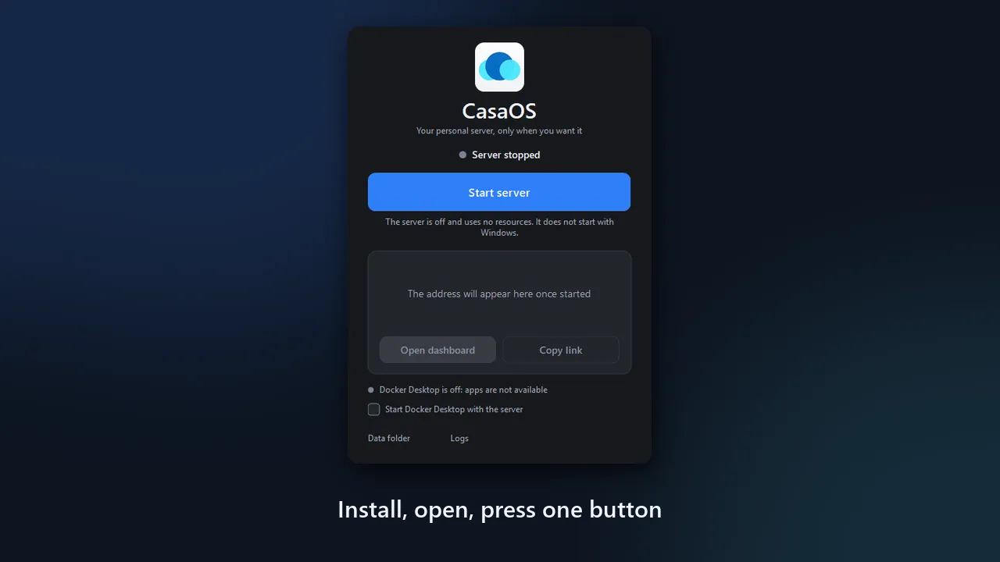
</p>

## What makes it different

| | |
|---|---|
| **Runs natively** | The six CasaOS services are real Windows programs. The dashboard and the file manager need no WSL and no virtual machine. |
| **On only when you want** | No Windows service, no scheduled task, no start with Windows. When it is off, it uses nothing. |
| **Installs like any other program** | A normal wizard, no terminal, no administrator rights. It uninstalls just as cleanly. |
| **The real dashboard** | The official CasaOS dashboard, unmodified. The port works underneath it. |
| **Your whole PC** | `C:`, `D:` and your other drives show up in the file manager, next to the CasaOS data folder. |
| **Apps through Docker Desktop** | The App Store catalog (667 apps when last checked) installs apps as containers. This part needs Docker Desktop and [has not been fully tested yet](#status). |

## Get started

1. Download `CasaOS-Setup-0.4.15.exe` from the [latest release](https://github.com/maxpy9/CasaOS-Windows/releases/latest).
2. Run it and choose where to keep your files.
3. Open **CasaOS**, press **Start server**, then **Open dashboard**.
4. **Create your account right away.** Until the first account exists, anyone who can reach the address could create it.

You need Windows 10 version 1809 or later, or Windows 11, 64-bit. Only Windows 11 has been tested so far. To install apps you also need [Docker Desktop](https://www.docker.com/products/docker-desktop/).

> [!NOTE]
> The programs are not signed with a paid certificate, so three things can happen the first time:
> - **SmartScreen** may say "Windows protected your PC". Choose *More info*, then *Run anyway*.
> - **Your antivirus** may hold the services for a while to analyze them. The window detects this and tells you instead of failing.
> - **Windows Firewall** may ask for network permission. Allow private networks only if you want to reach the dashboard from your phone or another PC.
>
> Each release lists the SHA256 of the installer, and you can [build it yourself](#build-it-yourself) from this code.

## A look around

Real screenshots, taken from a test copy on an empty account.

<table>
  <tr>
    <td width="32%" align="center">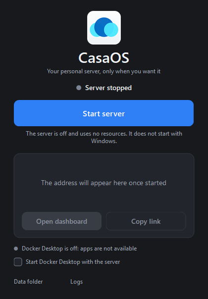<br><sub>Off, and using nothing</sub></td>
    <td width="68%" align="center">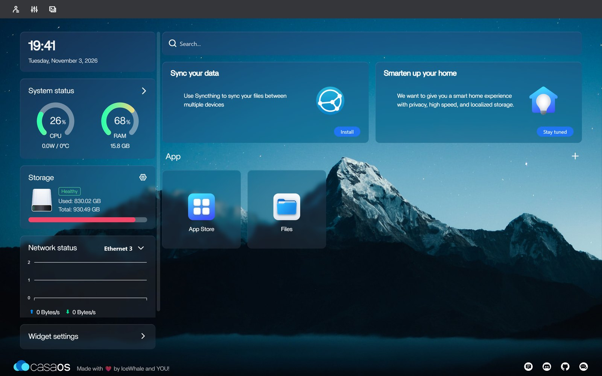<br><sub>The dashboard, with live CPU, memory, storage and network</sub></td>
  </tr>
  <tr>
    <td width="32%" align="center">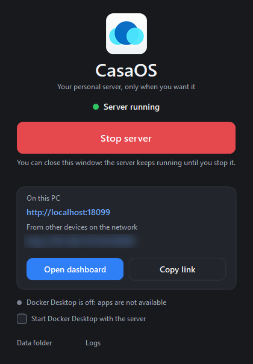<br><sub>On, with the links (network address blurred)</sub></td>
    <td width="68%" align="center">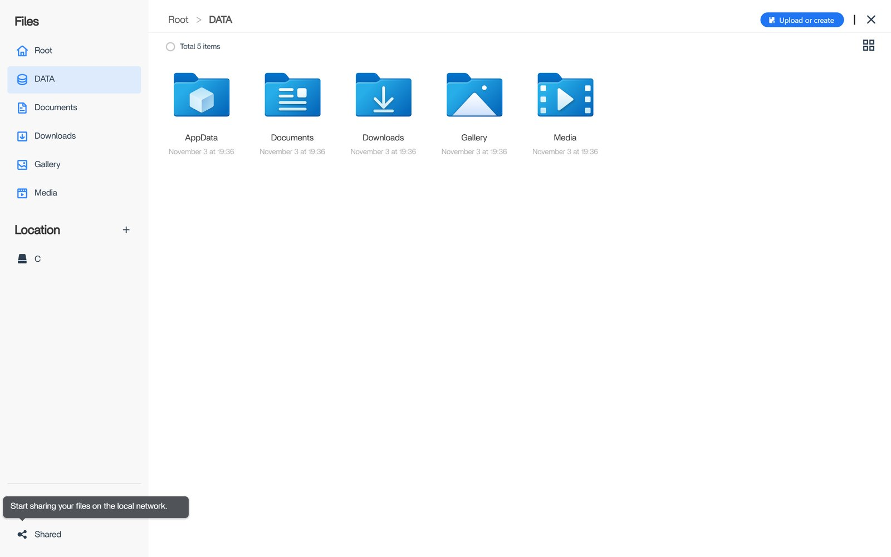<br><sub>Files: the data folder and the drives of the PC</sub></td>
  </tr>
  <tr>
    <td colspan="2" align="center">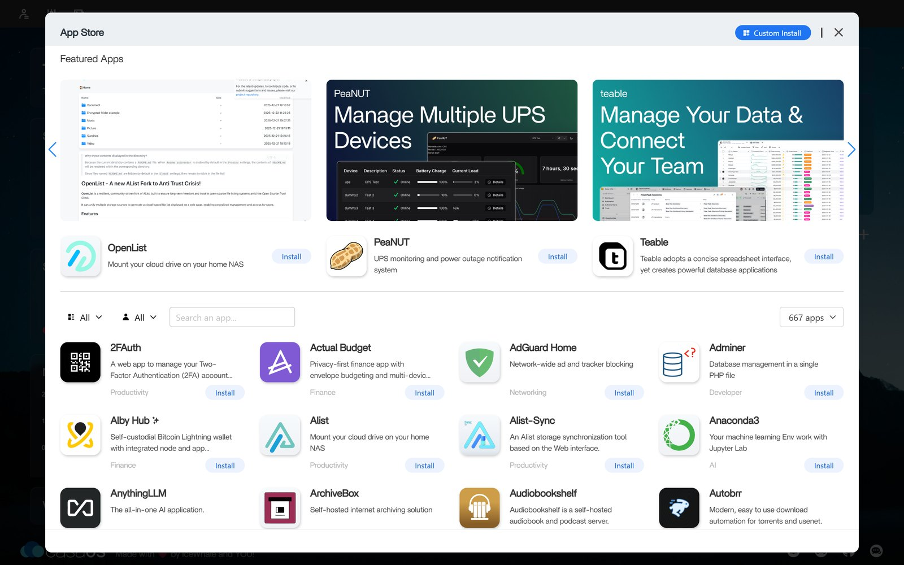<br><sub>The App Store catalog</sub></td>
  </tr>
</table>

## How it works

### On and off, for real

On Linux, CasaOS assumes it owns the machine and stays on all the time. That makes sense for a server, not for the laptop you also use for everything else.

<p align="center"></p>

### One window in charge

CasaOS is not one program but six, and on Linux `systemd` keeps them running. Here that job belongs to `CasaOS.exe`.

<p align="center">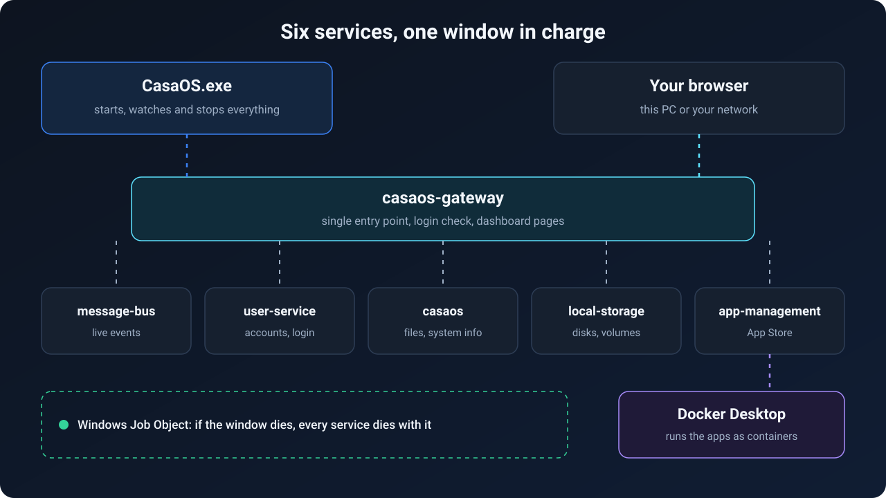</p>

The launcher starts each service in order and waits until it is ready. If one crashes it restarts it, up to five times in two minutes, then stops the server and tells you. All services live inside a Windows Job Object, so even if the launcher is killed, Windows closes them too and nothing is left behind.

On the test PC the server starts in about 4 seconds and stops in under one, once the antivirus has finished with the new programs.

### Linux paths on a Windows disk

The dashboard and the APIs are full of paths like `/DATA` and `/var/lib/casaos`. Rewriting all of them would have meant forking the dashboard, so they stay. One small package, [`vfs`](CasaOS-Common/utils/vfs), translates them at the last moment.

<p align="center">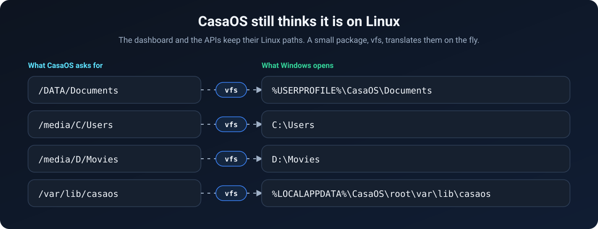</p>

### What had to be replaced

<p align="center">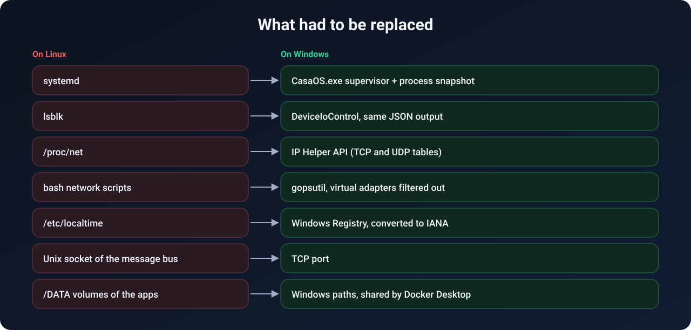</p>

<details>
<summary><b>The technical details, file by file</b></summary>

**Launcher** ([`CasaOS-Windows/launcher`](CasaOS-Windows/launcher))
- `ui.go`, `win32.go`, `i18n.go`: a native window written in Go that calls `user32`, `gdi32`, `gdiplus`, `dwmapi` and `shell32` directly, with no WebView or Electron. Light and dark theme, HiDPI, notification area icon, Italian and English.
- `server.go`: starts `casaos-gateway`, `casaos-message-bus`, `casaos-user-service`, `casaos`, `casaos-local-storage` and `casaos-app-management` in that order. If port 80 is taken, the gateway picks a free one.
- `suspended.go`: reads the thread states with `NtQuerySystemInformation`. If all the threads of a service are suspended, an antivirus is probably analyzing it, so the window waits and says so instead of reporting a failure.
- `docker.go`: checks Docker through the `\\.\pipe\docker_engine` named pipe. When you stop the server, it stops only the containers CasaOS created, remembers them in `apps-stopped-with-server.json` and restarts them next time. Your other containers are left alone, and Docker Desktop is closed only if the launcher opened it.

**Paths** ([`CasaOS-Common/utils/vfs`](CasaOS-Common/utils/vfs))
- `vfs.Real` turns a CasaOS path into a Windows path, and `vfs.Virtual` does the opposite before answering the dashboard. On Linux both return the path unchanged.

**Windows versions of the Linux parts**

| Linux | Windows | File |
|---|---|---|
| `lsblk -O -J -b` | `DeviceIoControl`, `GetVolumeInformation`, `GetDiskFreeSpaceEx`, no administrator rights | [`lsblk_windows.go`](CasaOS-LocalStorage/pkg/utils/command/lsblk_windows.go) |
| `systemctl` | `CreateToolhelp32Snapshot` | [`systemctl_windows.go`](CasaOS-Common/utils/systemctl/systemctl_windows.go) |
| `/proc/net/{tcp,udp}` | `GetExtendedTcpTable`, `GetExtendedUdpTable` | [`ports_in_use_windows.go`](CasaOS-Common/utils/port/ports_in_use_windows.go) |
| bash network scripts | `gopsutil`, hiding WSL, Hyper-V, Docker and VPN adapters | [`system_windows.go`](CasaOS/service/system_windows.go) |
| `/etc/localtime` | `TimeZoneKeyName` from the Registry, converted to IANA | [`utils_windows.go`](CasaOS-Common/utils/time/utils_windows.go) |
| app volumes on `/DATA` | `useHostVolumePaths()` swaps in the Windows path | [`volume_path.go`](CasaOS-AppManagement/service/volume_path.go) |

</details>

## How it was made

<p align="center"></p>

The idea came from [maxpy9](https://github.com/maxpy9): CasaOS on Windows with no terminal, controlled by one button. The code was written with [Claude Code](https://claude.com/claude-code), Anthropic's AI coding tool, and tested by running it on a real PC. The commits say so too. It is young software, so judge it by what is in the [status table](#status) rather than by how polished this page looks.

Running on Windows exposed problems that stayed hidden on Linux:

- An `unsafe` cast between two structs of different sizes in the network counters read past the end of the variable and crashed the service.
- Files left open, which Linux tolerates but which block renaming and deleting on Windows.
- Fatal errors when the message bus was not ready yet, and crashes on a GET request without a `Content-Type`.
- The message bus socket file could not be deleted after use, which broke the second start. On Windows it now uses a TCP port.

## Status

| | Feature | |
|---|---|---|
| ✅ | Install from the wizard, open the dashboard | Tested |
| ✅ | Starting and stopping the server, repeatedly | Tested |
| ✅ | Account, login, file manager, App Store catalog | Tested |
| ✅ | Docker Desktop starting and stopping with the server | Tested |
| ✅ | Uninstall | Tested in a test environment |
| 🟡 | **Installing a real app from the App Store** | **Not tested yet** |
| 🟡 | Apps stopping and returning with the server | Not tested with a real app |
| 🟡 | Opening the dashboard from another device | Not tested yet |
| 🟡 | Windows 10, other Windows 11 builds, other antivirus | Not tested yet |
| ❌ | Samba shares and network folders | Not available |
| ❌ | Google Drive, Dropbox, OneDrive | Not available |
| ❌ | Formatting and partitioning, mergerfs, USB eject | Not available |
| ❌ | S.M.A.R.T. data, CPU temperature and power (they show 0) | Not available |
| ❌ | Updating from the dashboard (official updates are Linux programs) | Not available |

All tests so far ran on one PC with Windows 11 and Norton 360. The terminal in the dashboard connects over SSH, so it needs the OpenSSH Server of Windows. Inside Docker Desktop, apps that use `network_mode: host` or hardware devices may behave differently than on Linux.

## Security

- **Browsers must always log in.** CasaOS trusts requests from `127.0.0.1`. On a desktop PC, that could let any website open in your browser reach `http://localhost` and read your files. So here the gateway treats every request whose `User-Agent` starts with `Mozilla/` as remote, and it must carry a login token. Other programs on the PC are still treated as local, like in the original.
- **Your drives are reachable from the dashboard.** Anyone with your account can browse every disk on the PC over the network. Use a strong password and do not expose the port to the Internet.
- **Protected roots.** The file manager will not delete, move or rename `/`, `/DATA`, `/media` or the root of a drive.
- **No embedded keys.** The original sources included OAuth credentials for Google Drive, Dropbox and GitHub. They were removed, since those features do not run on Windows.

Found a problem? Please open an issue, and for anything sensitive avoid posting the details publicly.

## Where your data lives

| What | Where | When you uninstall |
|---|---|---|
| Programs and dashboard | `%LOCALAPPDATA%\Programs\CasaOS` | Removed |
| Your files and app data (`/DATA`) | Chosen in the installer, by default `%USERPROFILE%\CasaOS` | **Never touched** |
| Accounts, settings, logs | `%LOCALAPPDATA%\CasaOS\root` | The uninstaller asks you |

## Build it yourself

The setup script installs nothing on your system: it downloads portable copies of Go, Inno Setup and the dashboard into `_tools`.

```powershell
.\CasaOS-Windows\setup-tools.ps1
.\CasaOS-Windows\build.ps1
```

The installer ends up in `CasaOS-Windows\dist`. If PowerShell blocks local scripts, run them with `powershell -ExecutionPolicy Bypass -File <script>`. More options are in the [launcher's README](CasaOS-Windows/README.md).

## FAQ

<details>
<summary><b>Is it a virtual machine or WSL?</b></summary>

No. The six CasaOS services are native Windows programs. Only the apps from the App Store run in a Linux environment, the one that comes with Docker Desktop.
</details>

<details>
<summary><b>Does it slow down my PC when I'm not using it?</b></summary>

When the server is off, no CasaOS process is running. It does not start with Windows either.
</details>

<details>
<summary><b>Why does my antivirus or SmartScreen complain?</b></summary>

The programs are new and not signed with a paid certificate, which is enough to trigger these warnings. The code is all here. If you would rather not trust a prebuilt installer, you can build your own.
</details>

<details>
<summary><b>Can I close the window?</b></summary>

Yes. With the server on, it moves to the notification area and keeps running until you stop it. With the server off, closing it quits the program.
</details>

<details>
<summary><b>Will the "Shut down" button in the dashboard turn off my PC?</b></summary>

Yes. Shut down and Restart in the dashboard act on the real Windows PC.
</details>

## Help wanted

The most useful thing right now is trying it and reporting what happens:

- **Install an app from the App Store** with Docker Desktop, and tell us whether it works.
- **Try it on Windows 10** or with a different antivirus.
- **Open the dashboard from your phone** or another PC.

[Open an issue](https://github.com/maxpy9/CasaOS-Windows/issues/new) with what you tried and what you saw. Pull requests are welcome too. If you like the idea, a star helps other people find it.

## Credits and license

All the real work behind CasaOS is by [IceWhale Technology](https://github.com/IceWhaleTech) and its contributors. This project is distributed under the [Apache License 2.0](LICENSE), like the originals, and the changes are listed in [NOTICE](NOTICE). The software comes *as is*, with no warranty.

| Folder | Original repository | Based on commit |
|---|---|---|
| `CasaOS` | [IceWhaleTech/CasaOS](https://github.com/IceWhaleTech/CasaOS) | `0d3b2f4` |
| `CasaOS-Common` | [IceWhaleTech/CasaOS-Common](https://github.com/IceWhaleTech/CasaOS-Common) | `909dcbd` (`v0.4.11-alpha4`) |
| `CasaOS-Gateway` | [IceWhaleTech/CasaOS-Gateway](https://github.com/IceWhaleTech/CasaOS-Gateway) | `606a845` |
| `CasaOS-MessageBus` | [IceWhaleTech/CasaOS-MessageBus](https://github.com/IceWhaleTech/CasaOS-MessageBus) | `ba87168` |
| `CasaOS-UserService` | [IceWhaleTech/CasaOS-UserService](https://github.com/IceWhaleTech/CasaOS-UserService) | `800c630` |
| `CasaOS-LocalStorage` | [IceWhaleTech/CasaOS-LocalStorage](https://github.com/IceWhaleTech/CasaOS-LocalStorage) | `a9b1280` |
| `CasaOS-AppManagement` | [IceWhaleTech/CasaOS-AppManagement](https://github.com/IceWhaleTech/CasaOS-AppManagement) | `debfa31` |

The dashboard in the installer is release v0.4.25 of [CasaOS-UI](https://github.com/IceWhaleTech/CasaOS-UI), unmodified. `CasaOS-Windows` and `CasaOS-Common/utils/vfs` were written for this port.
